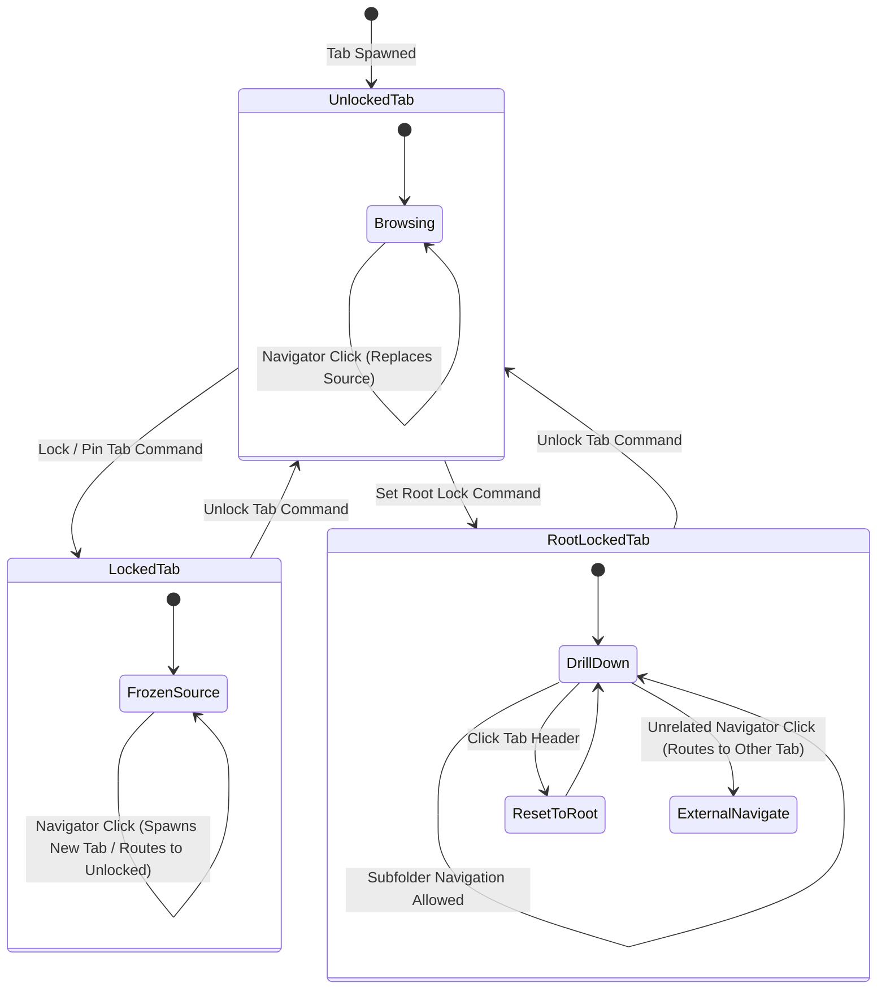

# Modular Decoupled UI Architecture Specification (Phase 6)

## 1. Executive Architectural Overview

PicAudio implements a decoupled four-layer UI architecture inspired by modular workstation interfaces:
1. **Window Panel Zones**: Fixed structural display containers that partition the window frame.
2. **Tabs**: Independent, stateful workspace instances maintaining their own data source, view template, sub-filters, sorting, and layout overrides.
3. **Data Sources / Nodes**: Media sources originating from the indexed database, rule-based virtual filters, playlists, staging nodes, or raw filesystem paths.
4. **View Modes & Layout Overrides**: High-level rendering templates (spreadsheets, grids, split views) that can dynamically collapse or override surrounding panel zones.

```mermaid
graph TD
    subgraph Layer 1: Window Panel Zones
        Z1["Header Bar"]
        Z2["Top Panel"]
        Z3["Left Sidebar"]
        Z4["Left Main Panel"]
        Z5["Main Panel (Workspace)"]
        Z6["Right Main Panel"]
        Z7["Right Sidebar"]
        Z8["Bottom Panel"]
        Z9["Floating Window"]
    end

    subgraph Layer 2: Stateful Tab Workspace
        T["Active Tab State"]
        T --> S["sourceId (Data Source / Node)"]
        T --> V["viewId (View Definition)"]
        T --> F["subFilterState (Cascading Browsers)"]
        T --> O["sortOrder & groupBy"]
        T --> L["layoutOverrides Map"]
    end

    subgraph Layer 3: Data Sources
        DS1["Built-in Nodes (Music, Inbox, Audiobooks, Podcasts)"]
        DS2["Rule-based Virtual Filters"]
        DS3["Playlists (Static & Auto-Playlists)"]
        DS4["Computer Node (Live OS Folders)"]
    end

    subgraph Layer 4: View Modes & Overrides
        VM1["Tracks Spreadsheet View"]
        VM2["Album & Tracks Split View"]
        VM3["Album Covers Grid View"]
        VM4["Artists Photo Grid View"]
        VM5["Jukebox Presentation View"]
        VM6["Custom Named Saved Views"]
    end

    T -.-> Z5
    DS1 & DS2 & DS3 & DS4 --> S
    VM1 & VM2 & VM3 & VM4 & VM5 & VM6 --> V
    L -.->|Dynamic Collapse / Edge Hover| Z2 & Z3 & Z4 & Z6 & Z7
```



---

## 2. Window Panel Zones & Modular Docking Engine

The application viewport is divided into **9 fixed structural zones**. Users do not position free-form pixel-coordinate windows; modular UI elements (up to 21 distinct widgets) are assigned to these 9 structural zones via the central **Panels Configuration** manager (`Arrange Panels`).

### The Nine Structural Zones

| Zone Name | Spatial Position | Resizing & Collapse Behavior | Typical Assigned Elements |
| :--- | :--- | :--- | :--- |
| **Header Bar** | Topmost horizontal band (caption bar or directly below) | Fixed height; wraps to multi-row if custom command buttons require it | Main Menu, Tabs Bar, Search Box, Configure Layout button, Action Buttons |
| **Top Panel** | Full-width horizontal band spanning above sidebars and center workspace | Vertically resizable via bottom drag splitter; collapses to `0px` when empty | Player Controls, Wavebar, Spectrum Visualizer, Now Playing Bar |
| **Left Sidebar** | Outer-left vertical column | Horizontally resizable; supports **Permanent**, **Hidden**, or **Auto-Open on Left Screen Edge Hover** modes | Navigator (library tree), Album Cover, Track Information, Playing Tracks |
| **Left Main Panel** | Inner-left vertical column (between Left Sidebar and Main Panel) | Horizontally resizable; hideable globally or per-tab/per-view via Layout Overrides | Thumbnail Browser, Library Explorer, Artist Biography, Album Cover |
| **Main Panel** | Central workspace area | Fills all remaining viewport dimensions dynamically | Files view (active tab renderer), A-Z Jump Bar, Column Browser, Thumbnail Browser |
| **Right Main Panel** | Inner-right vertical column (between Main Panel and Right Sidebar) | Horizontally resizable; hideable globally or per-tab/per-view via Layout Overrides | Album Cover, Artist Biography, Artist Picture, Lyrics |
| **Right Sidebar** | Outer-right vertical column | Horizontally resizable; supports **Permanent**, **Hidden**, or **Auto-Open on Right Screen Edge Hover** modes | Playing Tracks (Now Playing queue), Track Information, Lyrics, Sidebar Player |
| **Bottom Panel** | Full-width horizontal band at the window base | Fixed or vertically resizable depending on child elements | Player Controls (transport deck), Status Bar (counts, duration, sidebar toggles) |
| **Floating Window** | Detached OS-level secondary window | Independent window lifecycle; active only when at least 1 element is assigned | Lyrics, Artist Biography, Playing Tracks, Spectrum Visualizer, Sidebar Player |

### Element Stacking, Sub-Tabs, and Splitters

When multiple elements are placed within a single zone (e.g. Right Sidebar or Left Main Panel):
1. **Unstacked Sequential Split**: Elements share the zone vertically, separated by resizable splitters.
2. **Stacking (Shared Container Space)**: Consecutive elements with the `stacked: true` property merge into a single bounding box:
   - **Sub-Tabs Mode**: Displays a miniature horizontal tab strip at the panel header to switch active elements.
   - **Header Selector / Cycle Mode**: Single header with a dropdown menu, or clicking header text cycles to the next stacked item.
3. **Panel Splitters**: Inserting a dedicated `PanelSplitter` breaks an active stack into multiple independent stacked boxes within the same zone.

---

## 3. Tab State Model & Navigation State Machine

A **Tab** is an isolated view-controller instance. Switching tabs does not reload or re-index the library; it swaps the active view model, filters, and panel visibility overrides instantaneously.

### Tab State Schema
```json
{
  "tabId": "tab_c791a82f",
  "title": "Lossless Archive",
  "lockMode": "unlocked", // "unlocked" | "locked" | "root_locked"
  "rootSourceId": "folder:///media/flac_archive",
  "sourceId": "folder:///media/flac_archive/Jazz",
  "viewId": "covers_default",
  "subFilterState": {
    "jumpBarLetter": "M",
    "thumbnailSelection": "Miles Davis",
    "columnBrowserSelections": {
      "genre": "Jazz",
      "artist": "Miles Davis",
      "album": "Kind of Blue"
    }
  },
  "sortOrder": [
    { "field": "year", "direction": "asc" },
    { "field": "album", "direction": "asc" },
    { "field": "track_number", "direction": "asc" }
  ],
  "groupBy": "album_artist",
  "layoutOverrides": {
    "leftSidebar": "permanent",
    "leftMainPanel": "hidden",
    "rightMainPanel": "hidden",
    "rightSidebar": "auto_open",
    "columnBrowser": "visible",
    "thumbnailBrowser": "hidden",
    "jumpBar": "visible"
  }
}
```

### Tab Lock State Machine
- **Unlocked Tab (Default)**: Dynamic target. Clicking a node or folder in the Navigator replaces the active tab's `sourceId` and updates its title.
- **Locked / Pinned Tab**: Frozen source. Navigation from the Navigator is diverted to an existing unlocked tab or spawns a new tab. Pinned tabs display a compact icon or fixed header.
- **Partially Locked (Root-Locked) Tab**: Restricted to a designated root folder or virtual filter. Users can drill down into subdirectories or filter branches, but clicking the tab header resets the path back to the locked root, and clicking external Navigator nodes opens in a different tab.



---

## 4. Multi-Location File Indexing & Data Sources (Nodes)

PicAudio decouples how files are indexed and accessed across tabs:
1. **Multiple Database Libraries**: Full database isolation at the root selector (`Only one library open at a time`).
2. **Primary Media Nodes**:
   - `Music`: Main catalog.
   - `Inbox`: Staging library for unorganized downloads from monitored folders before tagging and moving into `Music`.
   - `Audiobooks`, `Podcasts`, `Video`: Specialized media partitions.
3. **Rule-Based Virtual Filters**: Dynamic boolean query slices under the `Music` node (e.g. `Path starts with "D:\HiRes"` AND `Bit Depth >= 24`). Rendered as child tree items under `Music`, each openable in dedicated tabs with distinct views.
4. **Computer Node (Live OS Explorer)**: Direct disk filesystem access. Files and tags are read on the fly without mandatory database indexing, supporting the full suite of views and tag editing.
5. **Playlists**: Static playlists (`.mbp`, `.m3u8`) with preserved natural `#` playback orders and Auto-Playlists capable of querying any library node or raw disk path.

---

## 5. Main Panel View Modes & Custom Saved Views

The Main Panel renders the active tab's files using one of five base view modes or a named Custom Saved View:

### Built-in View Modes
1. **Tracks View**: High-density multi-column spreadsheet table with expandable grouping headers (by Artist, Year, Genre), inline cell tag editing, and customizable column widths.
2. **Album and Tracks View**: Hybrid view featuring album artwork on the left and a multi-column tracklist to the right of the artwork.
3. **Album Covers View**: Responsive artwork thumbnail grid. Clicking an album cover expands an inline drawer/tray displaying the album's tracklist without leaving the grid.
4. **Artists View**: Responsive grid of artist photos that drills down into the artist's discography when selected.
5. **Jukebox View**: Presentation-oriented party mode with oversized artwork, prominent typography, and playback queue deck.

### Synchronized Views vs. Custom Saved Views
- **Synchronized Base Views**: If Tab 1 and Tab 2 both use `Tracks View`, column customizations in Tab 1 immediately reflect in Tab 2.
- **Custom Saved Views (`Saved Views`)**: Named independent templates created via `Copy Current View Settings To...`. Each Saved View maintains its own column definitions, thumbnail sizes, sort hierarchies, and **Panel Layout Overrides**.

### Panel Layout Overrides Matrix
Every view (built-in or custom) can specify layout overrides that take effect whenever a tab using that view is active:
- Collapsing `Left Main Panel`, `Right Main Panel`, `Top Panel`, or in-panel browsers.
- Switching `Left Sidebar` or `Right Sidebar` between **Permanent** and **Auto-Open Edge Hover** mode.
- Restoring hidden panels immediately when navigating to another tab without overrides.

---

## 6. Secondary In-Tab Browsers & Cascading Filtering

Each tab can host up to four interactive filter components:
1. **A-Z Jump Bar**: Horizontal or vertical alphabet strip (`#`, `A`–`Z`) for immediate filtering or smooth scrolling to the alphabetical offset.
2. **Thumbnail Browser**: Vertical scrolling list of tag values (Artist, Album Artist, Genre) with optional artwork thumbnails.
3. **Column Browser**: Cascading multi-column panes (e.g. `Genre` -> `Artist` -> `Album`). Clicking "Rock" in Column 1 restricts Column 2 and Column 3 to Rock artists and albums; changing Column 2 resets Column 3 to "All" while preserving Column 1. Supports header reordering, track counts in parentheses, and count-based sorting.
4. **Library Explorer**: Hierarchical tag tree (`Genre \ Artist \ Album`) with type-to-search jump navigation.

### Drag-and-Drop Metadata Tagging
The **Thumbnail Browser** and **Column Browser** act as drop targets. Dragging selected tracks from the Main Panel onto a browser entry (e.g. onto "Jazz" in Genre) prompts for confirmation and writes that tag directly to the dropped audio files.

---

## 7. Decoupled Selection vs. Playback Context

A core architectural invariant:
- **Selection Context**: Governs inspectable UI elements (Track Inspector, Tag Editor, Selected Album Art, Properties Panel). These update whenever the user clicks different tracks or switches tabs.
- **Playback Stream Context**: Governs playback controls, Player Deck, Wavebar Seekbar, Spectrum Visualizer, and Now Playing Lyrics/Biography. These **remain strictly locked** to the active audio pipeline output, regardless of what tab, folder, or playlist the user navigates to.

---

## 8. Runtime Event Pipeline & Tab Switch Lifecycle

When the user switches tabs:
1. Cache current tab's scroll position and in-tab filter selections (`subFilterState`).
2. Read target tab's `sourceId` and `viewId`.
3. Retrieve the View Definition from the registry and evaluate its `panelOverrides[]`.
4. Apply layout overrides to the 9 window zones (collapsing or restoring panels with smooth transitions).
5. Load or bind the target data source without re-indexing unchanged disk files.
6. Restore cached sub-browser filter selections and scroll offsets.
7. Update Selection Context without interrupting the continuous audio stream.
